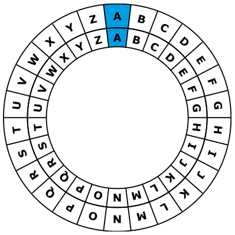

Anna bestellt im Restaurant mit geheimen Botschaften; nur Cäsar der Koch soll sie verstehen. Sie benutzt dazu ihre Geheimscheibe. Diese hat einen äußeren und einen inneren Ring mit den Buchstaben des Alphabets. Zu Anfang stehen die Ringe gleich: A (innen) passt zu A (außen), B passt zu B usw.

So erstellt Anna eine geheime Botschaft: Zuerst schreibt sie ihre Bestellung auf, z. B. PIZZA. Dann macht sie für jeden Buchstaben:

1. Unter den Buchstaben schreibt sie eine „Dreh-Zahl“.
2. Sie stellt den inneren Ring auf Anfang und dreht ihn dann um so viele Buchstaben nach links, wie die Dreh-Zahl angibt.
3. In die Botschaft schreibt sie den Buchstaben, der nun zum Buchstaben aus der Bestellung passt.

Ein Beispiel: Wenn Anna PIZZA haben will und die Dreh-Zahlen 3, 1, 4, 3 und 1 benutzt, erstellt sie die geheime Botschaft SJDCB. Bei Dreh-Zahl 3 passt S (innen) zu P (außen).

| Bestellung | P | I | Z | Z | A |
|---|---|---|---|---|---|
| Dreh-Zahlen | 3 | 1 | 4 | 3 | 1 |
| Botschaft | S | J | D | C | B |

Für eine andere Bestellung hat Anna mit den Dreh-Zahlen 3, 2, 1, 3 und 2 die Botschaft SCTWC erstellt.

| Bestellung | ? | ? | ? | ? | ? |
|---|---|---|---|---|---|
| Dreh-Zahlen | 3 | 2 | 1 | 3 | 2 |
| Botschaft | S | C | T | W | C |

**Wie lautet die Bestellung?** Schreibe die fünf Buchstaben der Bestellung auf.
