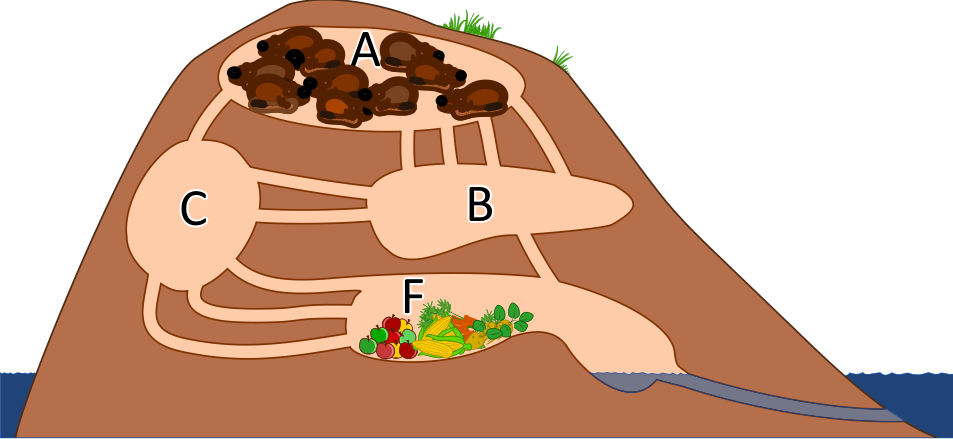

10 Biber befinden sich in Raum A ihrer Burg. Sie wollen möglichst rasch in den Raum F zum Fressen kommen.

Ein Biber braucht 1 Minute, um durch einen Gang zu laufen. Leider kann durch jeden Gang immer nur ein Biber gleichzeitig laufen. Es können also nicht mehrere Biber direkt hintereinander durch einen Gang laufen. In den Räumen A, B, C und F ist genug Platz für alle Biber, und das Durchqueren eines Raums kostet keine Zeit.

**Nach wie vielen Minuten können alle 10 Biber in Raum F sein? Gib die kürzest mögliche Zeit an!**
