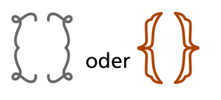

Die Firma „Klammerschmuck“ stellt Armbänder aus klammerförmigen Spangen her. Die Firma verwendet die Spangen immer paarweise, und immer in der gleichen Anordnung. Die Herstellung eines Armbands beginnt mit einem dieser Paare:

Danach werden wiederholt weitere Paare an beliebigen Stellen eingefügt. Hier sind Beispiele für drei verschiedene Armbänder (die Pfeile zeigen, wo ein Paar eingefügt wurde):

![Drei Beispiel-Armbänder: „{ { } } { }“, „{ [ { } ] }“ und „[ { } { { } } ]“ mit eckigen (grau) und geschweiften (orange) Klammern](./img/examples.png)

**Welches der folgenden Armbänder wurde von der Firma „Klammerschmuck“ hergestellt?**
