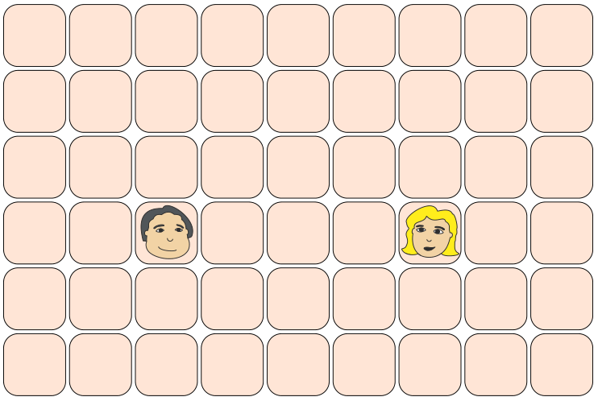

Elena und Dustin nehmen an einer Tanzshow teil. Je nach Reaktion des Publikums führen sie gleichzeitig bestimmte Tanzschritte aus. Die Tabelle zeigt, wie sie sich über die Felder der Tanzfläche bewegen:

Wenn zum Beispiel das Publikum kreischt, bewegt Elena sich um ein Feld nach oben und danach um ein Feld nach links; gleichzeitig bewegt sich Dustin um ein Feld nach rechts und danach um ein Feld nach unten.

Elena und Dustin starten auf der Tanzfläche auf diesen Feldern:

Das Publikum möchte, dass die beiden am Ende auf dem gleichen Feld stehen.

**Welche Reaktionen muss das Publikum dazu zeigen?**
