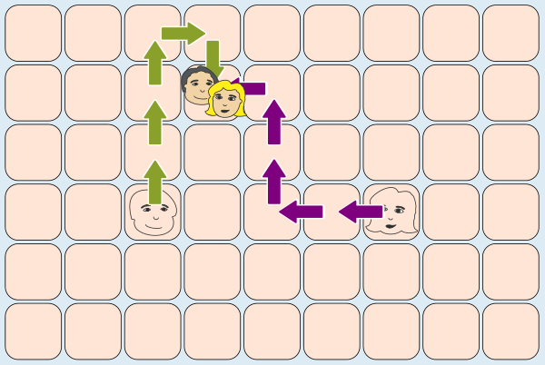
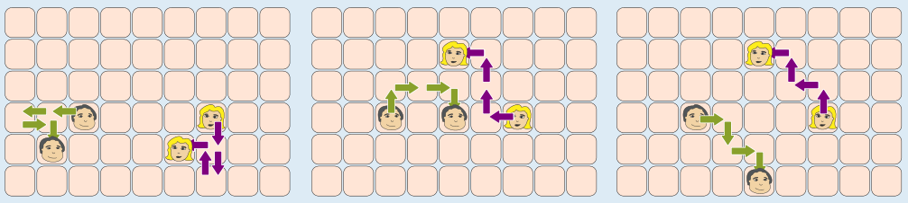

Antwort **D** ist richtig.

Bei „Klatsch! Kreisch!“ bewegt Elena sich um insgesamt zwei Felder nach oben und drei Felder nach links. Dustin bewegt sich insgesamt um ebenfalls zwei Felder nach oben und um ein Feld nach rechts. Beim Start waren beide auf gleicher Höhe und vier Felder auseinander. Am Ende sind sie wieder auf gleicher Höhe und haben sich um insgesamt vier Felder aufeinander zu bewegt. Sie stehen dann auf dem gleichen Feld. Das Bild zeigt die Bewegungen:

In allen anderen Fällen stehen Dustin und Elena am Ende nicht auf dem gleichen Feld:

## Das ist Informatik!

In dieser Biberaufgabe handeln zwei Akteure, nämlich Dustin und Elena (oder waren es Justin und Selena?) unabhängig voneinander. Dabei sollen die Akteure eines ihrer Arbeitsmittel (ein Feld auf der Tanzfläche) gemeinsam benutzen. Das wird wohl gut gehen, denn die beiden haben sicher nicht zum ersten Mal an einer Tanzshow teilgenommen.

Die handelnden Akteure beim Betrieb eines Computers nennt die Informatik Prozesse. Auch sie sind grundsätzlich voneinander unabhängig. Die Arbeitsmittel (auch Ressourcen genannt) der Prozesse sind z. B. der Arbeitsspeicher des Computers oder an den Computer angeschlossene Geräte. Wenn zwei Prozesse zur gleichen Zeit dasselbe Arbeitsmittel benutzen wollen, geht das ohne Weiteres nicht gut. Wenn etwa zwei Prozesse die gleichen Bereiche im Arbeitsspeicher beschreiben dürften, gerieten alle ihre Berechnungen durcheinander.

Die Informatik hat deshalb viele Mechanismen entwickelt, um die Vergabe von Arbeitsmitteln an die Prozesse im Computer zu regeln. Umgesetzt sind sie im zentralen Steuerungssystem des Computers, dem Betriebssystem.
