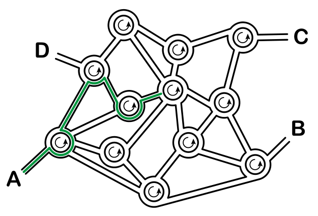

In Kreiselstadt gibt es nur Kreisverkehre und sonst keine anderen Kreuzungen. An vier Stellen A, B, C und D kann man in die Stadt hineinfahren. Unten siehst du einen Plan.

Wenn die Kreiselstädter einen Weg beschreiben, sagen sie zum Beispiel:

- Beim nächsten Kreisverkehr nimm die 4. Ausfahrt.
- Beim dann folgenden Kreisverkehr nimm die 1. Ausfahrt.
- Beim dann folgenden Kreisverkehr nimm die 2. Ausfahrt.

Einem einheimischen Fahrer sagen sie stattdessen nur kurz die Wegbeschreibung „4 1 2“. Von A aus führt diese Wegbeschreibung zu einem Kreisverkehr in der Stadtmitte (grün eingezeichnet):

**Wohin führt die Wegbeschreibung „3 1 3 2 3“ von A aus?**
