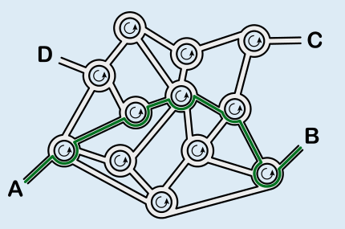

Antwort **B** ist richtig.

Wenn man von A aus der Wegbeschreibung folgt, erreicht man schließlich B.

## Das ist Informatik!

Diese Biberaufgabe liefert ein gutes Beispiel für formalisierte Information. Ein Steuerungscomputer kann mit einer ausformulierten Wegbeschreibung nicht viel anfangen. Wenn man aber eine Wegbeschreibung wie im Beispiel als Folge von Zahlen angeben kann, dann ist die Information in einer Form, die ein Computer als Folge von Befehlen interpretieren kann. So eine Befehlsfolge nennt man auch Sequenz. Die Sequenz ist ein wichtiger Baustein in fast allen Programmiersprachen.

In diesem Beispiel ist es hilfreich, dass das Straßennetz gleichförmig aufgebaut ist: Alle Kreuzungen sind Kreisverkehre. Solche gleichförmigen Strukturen nennt man homogen, im Gegensatz zu gemischten Strukturen, die als heterogen bezeichnet werden. Homogene Strukturen sind für Programme leichter abzuarbeiten als heterogene, weshalb man sie in der Informatik bevorzugt, wenn es keinen zwingenden Grund dagegen gibt.
