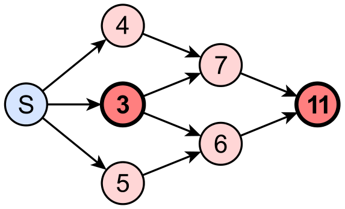

Das Bild stellt ein Netzwerk aus Einbahnstraßen (Pfeile) und Kreuzungen (Kreise) dar. Bis auf Kreuzung S ist jede Kreuzung mit einer Zahl markiert. Die Zahl gibt die Länge des kürzesten Weges von S zu dieser Kreuzung an.

Betrachte die beiden mit starkem Rand abgebildeten Kreuzungen (3 und 11).

**Welche der folgenden Aussagen über diese beiden Kreuzungen ist sicher wahr?**
