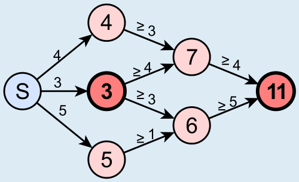

Antwort **C** ist richtig: Der kürzeste Weg zwischen diesen beiden Kreuzungen ist 8 oder mehr.

Wäre der kürzeste Weg weniger als 8, so wäre der kürzeste Weg zwischen S und der Kreuzung mit „11“ weniger als 3 + 8 = 11. Der kürzeste Weg könnte aber länger als 8 sein, da der kürzeste Weg zwischen S und der Kreuzung mit „11“ auch über die Kreuzungen mit „4“ und „7“ oder über die Kreuzungen mit „5“ und „6“ führen könnte. Damit sind die anderen Antworten falsch.

Das Bild zeigt, wie lang die einzelnen Einbahnstraßen mindestens sein müssen, damit die Zahlen der Kreuzungen stimmen.

## Das ist Informatik!

Auf den ersten Blick scheint es in dieser Aufgabe lediglich um den kürzesten Weg zwischen zwei Kreuzungen zu gehen. Dafür müsste man aber die tatsächliche Entfernung zwischen zwei Kreuzungen wissen, die man üblicherweise als Weglänge an den Weg schreibt. In diesem Fall jedoch ist nur die Länge des kürzesten Wegs von S zu jeder Kreuzung notiert, es könnte zum Beispiel sein, dass der Weg von „4“ zu „7“ 10 lang ist, wenn der Weg von „3“ zu „7“ 4 lang ist. Daher kann man ohne weitere Informationen nicht sagen, welcher der möglichen Wege der kürzeste Weg ist.
