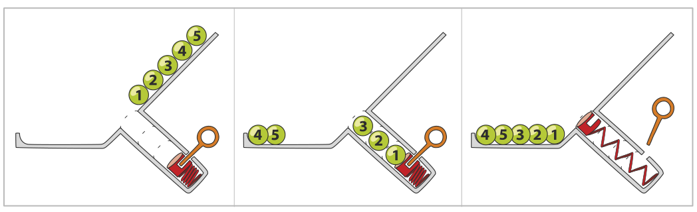
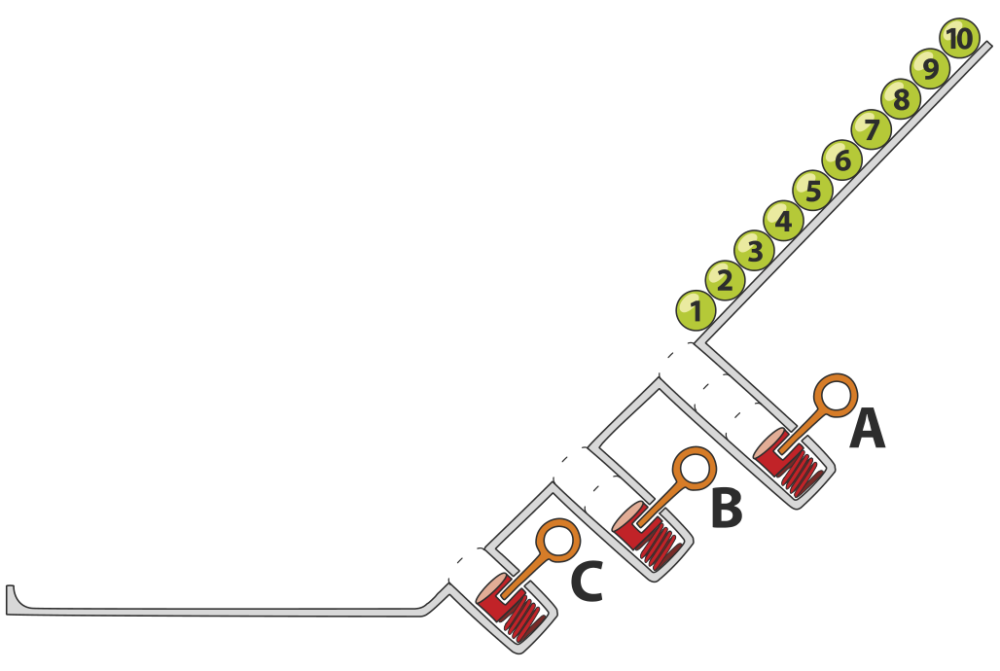

Eine Spielzeugfirma baut Kugelrampen: Nummerierte Kugeln rollen einen Abhang mit Löchern hinunter. Wenn eine Kugel zu einem Loch kommt, fällt sie hinein, wenn noch Platz ist; sonst rollt sie über das Loch. Die Kugeln in einem Loch werden mit einer Feder wieder hinausbefördert – aber nur, wenn gerade keine Kugel rollt. Zum Schluss liegen alle Kugeln am Ende der Rampe.

Hier ist eine Rampe für fünf Kugeln mit einem Loch. Das Loch hat Platz für drei Kugeln. Hier liegen die Kugeln zum Schluss in der Reihenfolge 4, 5, 3, 2, 1 am Ende der Rampe.

Hier ist eine Rampe für zehn Kugeln mit drei Löchern. Loch A hat Platz für drei Kugeln, Loch B für zwei Kugeln und Loch C für eine Kugel. Wenn die Löcher voll sind, werden die Federn in dieser Reihenfolge betätigt: zuerst an Loch A, dann an Loch B, dann an Loch C.

**In welcher Reihenfolge liegen die Kugeln zum Schluss?**
