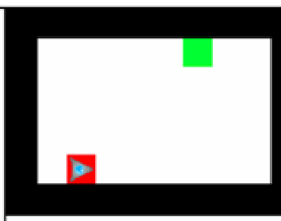

Der dreieckige Roboter soll vom roten Startfeld zum grünen Zielfeld gehen. Der Roboter kann nur sehr kurze Programme verarbeiten: Du darfst höchstens vier Bausteine für dein Programm benutzen.

Das Programm besteht aus diesen vier Bausteinen: **wiederhole** – darin **wenn der Weg vorne frei ist, mache …, sonst mache …**. Der Roboter kennt die Befehle „gehe vorwärts“, „drehe nach links“ und „drehe nach rechts“.

**Programmiere den Roboter! Welcher Befehl muss im Programm jeweils stehen?**
