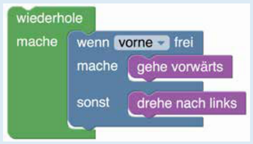

Startfeld und Zielfeld liegen an der Wand. Wenn der Roboter immer an der Wand entlang geht, erreicht er sicher das Zielfeld. Dazu kann er wiederholt Folgendes tun: Wenn der Weg vorne frei ist, geht er vorwärts; sonst (dann steht er vor einer Wand) dreht er nach links. Dieses Vorgehen kann man auch mit vier Programmbausteinen beschreiben:

## Das ist Informatik!

In dem 8 mal 5 Schritte großen Raum führt der Roboter 14 Bewegungen aus, um das Zielfeld zu erreichen: vor – vor – vor – vor – vor – vor – links – vor – vor – vor – vor – links – vor – vor. Das Programm, das den Roboter so steuert, hat aber nur vier Bausteine. Es macht sich eine Wiederholung (in der Informatik auch Schleife genannt) zunutze, um beliebig viele Vorwärtsschritte und Linkswendungen zu vollführen, bis das Ziel erreicht ist.

Außerdem enthält es eine bedingte Anweisung („wenn … mache … sonst …“), um bis zur nächsten Wand zu gehen und dann die Richtung zu ändern.

Allerdings findet dieses kurze Programm nicht den kürzesten Weg. Außerdem funktioniert es nicht in jeder Situation. Stelle dir vor, das Ziel läge nicht an einer Wand – würde der Roboter es jemals erreichen?
