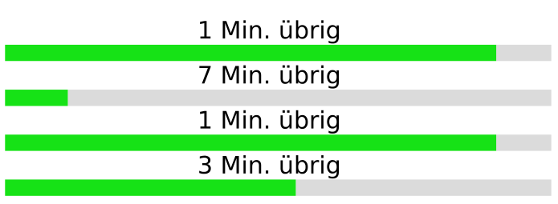

Lädt man mehrere Dateien gleichzeitig aus dem Internet, dann teilen sich diese Downloads die Kapazität der Internet-Verbindung gleichmäßig. Beim Laden von 10 Dateien gleichzeitig kann jede Datei nur ein Zehntel der Kapazität nutzen; das Laden einer Datei hätte die 10-fache Ladegeschwindigkeit.

Ein Benutzer lädt gerade 4 Dateien gleichzeitig herunter. Für jede Datei wird die verbleibende Ladezeit angezeigt. Diese Zeit wird anhand der aktuellen Verbindungskapazität berechnet:

In der Folgezeit bleibt die Verbindungskapazität gleich.

**Wie viele Minuten wird es dauern, bis alle 4 Dateien vollständig geladen sind?**
