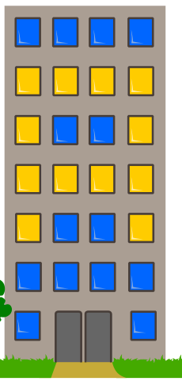

Das neue Hochhaus der Stadt hat 26 Fenster, hinter denen das Licht ein- und ausgeschaltet werden kann. Leider kann man das Licht jedes Fensters nicht einzeln ein- und ausschalten, sondern muss immer alle Lichter eines Stockwerks oder einer Fensterspalte vollständig an- oder ausschalten.

Die Lichter des Hochhauses sollen so leuchten wie im Bild (gelb = Licht an):

**Schalte die Lichter so, dass sie wie im Bild leuchten!** Klicke dazu auf die Nummern der Stockwerke bzw. die Buchstaben der Fensterspalten, um deren Lichter zu schalten.
