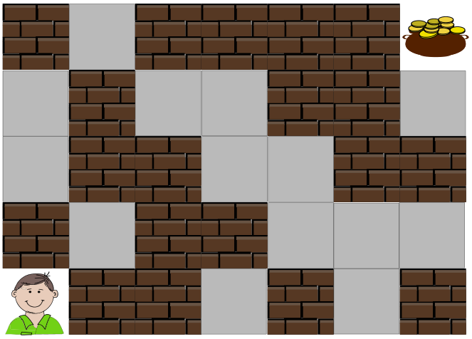

Eine Schatzkarte ist in Felder eingeteilt. Peter ist im Feld links unten und will zum Schatz rechts oben. Er kann immer zum nächsten Nachbarfeld gehen: nach oben, unten, rechts und links – aber nicht schräg.

Peter muss alle Mauern auf seinem Weg zum Schatz öffnen. Das ist anstrengend! Er sucht deshalb einen Weg, auf dem er möglichst wenige Mauern öffnen muss.

**Finde diesen Weg!** Entferne möglichst wenige Mauern, so dass ein Weg zum Schatz frei wird. Klicke auf ein braunes Mauerfeld im Raster unten, um die Mauer zu öffnen. Klicke erneut auf das Feld, um die Mauer wieder zu schließen. Das Raster entspricht der Karte; Peters Feld (unten links) und das Schatzfeld (oben rechts) sind gesperrt.
