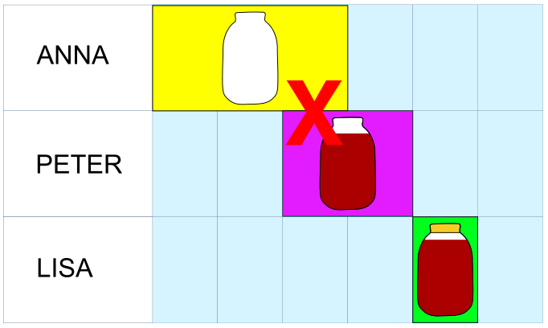

Opa kocht Marmelade. Anna, Peter und Lisa helfen ihm, die Marmelade in Gläser abzufüllen. Dazu müssen sie jeweils diese Arbeitsschritte erledigen – und zwar genau in dieser Reihenfolge:

1. Ein Glas spülen. Das dauert 3 Minuten.
2. Marmelade in das Glas füllen. Das dauert 2 Minuten.
3. Das Glas verschließen. Das dauert 1 Minute.

Anna, Peter und Lisa wollen sich die Arbeit aufteilen und dazu einen Plan erstellen. Dabei müssen sie beachten:

- Ein Arbeitsschritt muss komplett erledigt sein, bevor der nächste erledigt werden kann.
- Ein Glas muss ganz sauber sein, bevor man Marmelade einfüllt.
- Und das Glas darf natürlich erst verschlossen werden, wenn es fertig gefüllt ist.

Dieser Plan ist also nicht möglich:

Anna, Peter und Lisa wollen in 10 Minuten möglichst viele Gläser abfüllen.

**Erstelle einen Plan, mit dem sie das schaffen.** Der Plan sagt dir am Ende, wie viele Gläser fertig abgefüllt sind.
