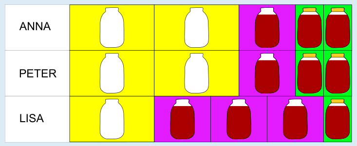

Fünf Gläser in 10 Minuten sind möglich. Hier ist ein Plan, mit dem Anna, Peter und Lisa fünf Gläser abfüllen können: Anna und Peter spülen je zwei Gläser (Minute 1–3 und 4–6), füllen je ein Glas ein (Minute 7–8) und verschließen je zwei Gläser (Minute 9 und 10). Lisa spült ein Glas (Minute 1–3), füllt drei Gläser ein (Minute 4–5, 6–7 und 8–9) und verschließt ein Glas (Minute 10).

Es gibt noch andere Pläne, mit denen sie das ebenfalls schaffen können. In diesen Plänen sind die drei Zeilen – also die Folgen von Arbeitsschritten, die die einzelnen Kinder erledigen sollen – gleich wie im abgebildeten Plan, aber anderen Kindern zugeordnet.

Das Abfüllen eines Marmeladenglases dauert 3 + 2 + 1 = 6 Minuten. Jedes der drei Kinder hat 10 Minuten Arbeitszeit. Somit beträgt die gesamte Arbeitszeit 30 Minuten. Es ist nicht möglich, in 30 Minuten mehr als fünf Gläser abzufüllen; denn 30 : 6 = 5. Fünf Gläser sind also auch theoretisch gesehen das Optimum. Es kann mit dem abgebildeten Plan erreicht werden.

## Das ist Informatik!

In dieser Biberaufgabe arbeiten Anna, Peter und Lisa gleichzeitig, also parallel an einer Aufgabe. Die Aufgabe kann zwar glücklicherweise in Teilschritte zerlegt werden, aber zwischen den Teilschritten besteht eine Abhängigkeit. Der nächste Teilschritt kann erst begonnen werden, wenn der frühere Teilschritt abgeschlossen ist. Diese sehr häufige Abhängigkeit nennt man „Finish-to-Start“-Abhängigkeit (es gibt auch „Start-to-Start“, „Finish-to-Finish“, „Start-to-Finish“). In einem großen Projekt gibt es sehr viele Teilschritte mit unterschiedlichen Abhängigkeiten. Zur Darstellung der Reihenfolge und Abhängigkeiten solcher Teilschritte werden Netzpläne verwendet. Innerhalb jedes solchen Netzplanes gibt es einen sogenannten „kritischen Pfad“. Er bestimmt die Projektlaufdauer und Verzögerungen in Teilschritten entlang dieses Pfads verlängern das Projekt.

Auch innerhalb eines Computers spielen solche Überlegungen eine wichtige Rolle. Ein Prozessor besteht heute meist aus mehreren Kernen (Recheneinheiten). Diese arbeiten parallel und wenn Aufgaben in Teilschritte zerlegbar sind, dann können diese durch verschiedene Kerne gleichzeitig abgearbeitet werden und somit schneller beendet werden.
