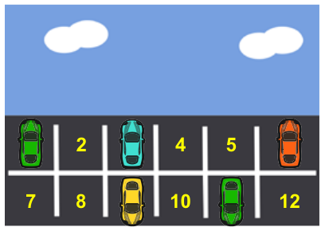
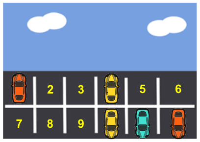

Ein Geschäft hat 12 Parkplätze für Autos. Die Parkplätze haben Nummern. Die Bilder zeigen, auf welchen Parkplätzen am Montag und am Dienstag Autos waren. Auf den belegten Parkplätzen ist die Nummer vom Auto verdeckt.

**Montag**

**Dienstag**

Einige Parkplätze waren an beiden Tagen frei, zum Beispiel Parkplatz 2.

**Wie viele Parkplätze waren an beiden Tagen frei?**
