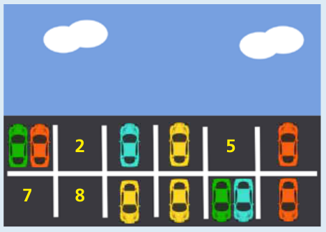

Antwort **B** ist richtig.

Wenn die Autos von beiden Tagen zusammen auf ihren Parkplätzen gezeigt werden, sehen wir, welche Parkplätze an beiden Tagen frei waren. Diese freien Plätze können dann einfach gezählt werden. Insgesamt waren 4 Parkplätze an beiden Tagen frei (die Plätze 2, 5, 7 und 8).



## Das ist Informatik!

Alle Arten von Daten können als eine Folge von Nullen und Einsen codiert werden. Eine solche Folge heißt Binärcode. Jede Stelle, wo eine Null oder Eins stehen kann, wird Bit genannt.

Bei dieser Aufgabe können wir die Anwesenheit eines Autos auf einem Parkplatz mit einer Eins (1) und eine Abwesenheit mit einer Null (0) codieren. So lässt sich die Belegung der Parkplätze als Binärcode modellieren: Für Montag ergibt sich der Binärcode 101001001010, für Dienstag 100100000111.

Mit Hilfe der logischen Operation ODER (englisch: OR) wird aus zwei Binärcodes ein neuer so berechnet, dass im Ergebnis alle diejenigen Bits 1 sind, die in mindestens einem der beiden Binärcodes auch 1 sind. Mit ODER erhalten wir also einen Parkplatz-Belegungs-Binärcode, der zeigt, wo an beiden Tagen Autos standen. Das Ergebnis von ODER können wir gut berechnen, indem wir die Binärcodes übereinander schreiben.

```
     101001001010
ODER 100100000111
=    101101001111
```

Der Ergebnis-Binärcode enthält 4 Nullen. Es waren also 4 Parkplätze an beiden Tagen frei.
