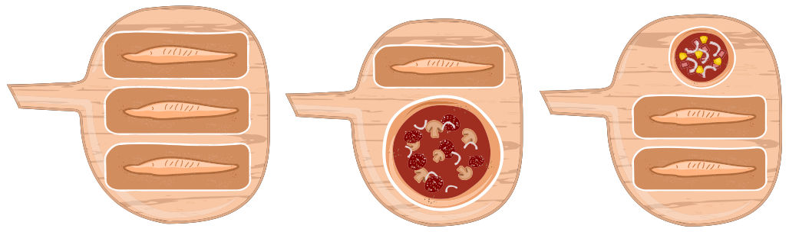

Die Pizzeria Biberia hat nur einen kleinen Pizzaofen. Deshalb kann der Pizzabäcker nur wenige Gerichte gleichzeitig backen, nämlich:

Der Pizzabäcker kann aber Gerichte einzeln in den Ofen legen oder aus dem Ofen holen. Die Gerichte müssen unterschiedlich lange im Ofen sein: eine kleine Pizza 10 Minuten, eine große Pizza 15 Minuten und ein Ciabatta-Brot 20 Minuten.

Heute ist viel los: Die Gäste bestellen

- eine kleine Pizza,
- zwei große Pizzen und
- vier Ciabatta-Brote.

Die Gäste sind hungrig. Der Pizzabäcker soll die bestellten Gerichte so schnell wie möglich backen.

**In wie vielen Minuten kann der Pizzabäcker die bestellten Gerichte so schnell wie möglich backen?**
