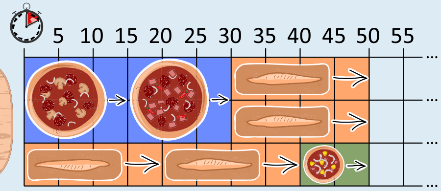

**50** ist die richtige Antwort.

Der Pizzabäcker kann die beiden großen Pizzen hintereinander backen, parallel dazu zwei Ciabatta-Brote und dann mit zwei Ciabatta-Broten und einer kleinen Pizza ergänzen:

Der Pizzabäcker kann die Gerichte also in 50 Minuten backen. Es gibt noch weitere Möglichkeiten, die Gerichte in 50 Minuten zu backen; z. B. kann der Pizzabäcker den abgebildeten Plan in umgekehrter Reihenfolge ausführen. Schneller kann es nicht gehen, da der Platz im Ofen während der 50 Minuten immer komplett ausgenutzt wird.

## Das ist Informatik!

Wenn man versucht, einen Ablaufplan (engl. schedule) für eine beschränkte Ressource (in diesem Fall der Pizzaofen) zu erstellen, möchte man in der Regel eine optimale Lösung finden, beispielsweise bezüglich der Kosten oder (wie in diesem Fall) bezüglich der Zeit. So wird die Ressource optimal genutzt und damit auch die kürzeste Backzeit erreicht.

Ein weit verbreitetes Verfahren zum Finden von optimalen Ablaufplänen ist das Rundlauf-Verfahren (engl. Round-Robin). Bei diesem Verfahren sind alle Prozesse, die stattfinden sollen, in einer Warteschlange. Jeder Prozess bekommt dann für eine kurze Zeit die Ressource zur Verfügung gestellt. Wenn er am Ende der kurzen Zeit noch nicht fertig ist, wird er wieder neu in die Warteschlange eingereiht. Für diesen Pizzaofen jedoch macht die Strategie nicht viel Sinn … man nimmt ja keine halbfertige Pizza aus dem Ofen und schiebt sie später wieder rein. Daher kann man in diesem Fall mit einer gierigen (engl. greedy) Strategie vorgehen: man fängt mit dem größten Prozess an (einer großen Pizza, da diese am meisten Platz wegnimmt) und versucht dann, mit nächstkleineren Prozessen aufzufüllen und so weiter. Da der Ofen (mit Einschränkungen) mehrere Dinge gleichzeitig backen kann, kann man auch immer jeweils das fertige Gericht herausnehmen und durch das nächste zu backende Gericht ersetzen.

Hat man aber am Ende die optimale Lösung gefunden? Das ist nicht offensichtlich, man könnte ja vielleicht eine bessere Lösung finden, indem man beispielsweise mit drei Ciabatta-Broten anfängt. Wenn man es aber geschafft hat, alle Ressourcen immer voll zu belegen (also in diesem Fall den Ofen immer voll zu haben), kann man sicher sein, dass es keine bessere Lösung gibt.
