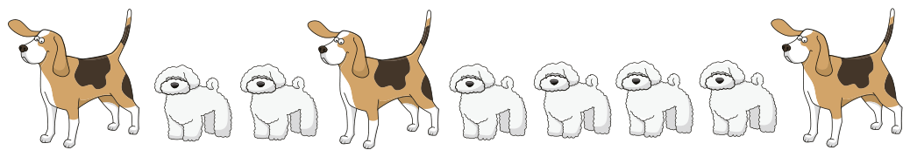
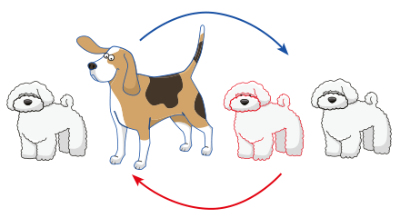

Hier ist eine Reihe von Hunden. Es gibt große und kleine Hunde.

Zwei Hunde, die nebeneinander stehen, können einen Platztausch machen: Sie tauschen dann ihre Plätze in der Reihe.

Die großen Hunde sollen nebeneinander stehen.

**Wie viele Platztausche müssen die Hunde dazu mindestens machen?**
