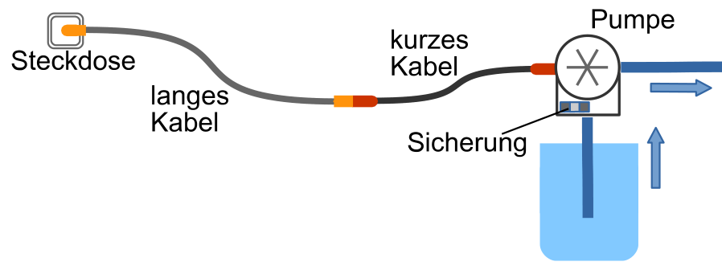

Ein Biber hat für seinen Gemüsegarten ein elektrisches Pumpsystem gebaut. Es ist über eine Steckdose mit dem Stromnetz verbunden und besteht aus diesen Teilen:

- einem langen Kabel,
- einem kurzen Kabel,
- einer Sicherung und
- einer Pumpe.

Eines Tages funktioniert das Pumpsystem nicht mehr. Der Biber nimmt an, dass nur ein Teil defekt ist. Das möchte er finden, indem er Teile austauscht. Er hat nämlich gebrauchte, aber garantiert voll funktionstüchtige Ersatzteile.

Von seinen Freunden erhält der Biber verschiedene Empfehlungen, wie er vorgehen soll.

**Wie soll der Biber vorgehen? Wähle die Empfehlung, mit der der Biber ein einzelnes defektes Teil sicher finden wird.**
