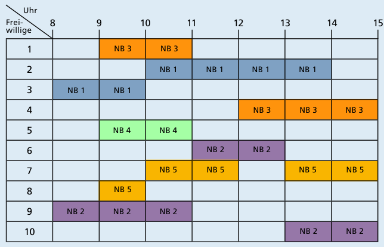
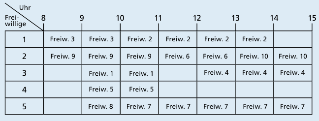

Antwort **B** ist richtig.

Antwort A ist falsch. Sie wäre passend, wenn zum Beispiel nach der maximalen Anzahl von Arbeitsstunden der einzelnen Freiwilligen gefragt worden wäre. Wurde es aber nicht.

Antwort B ist richtig. Wenn eine bestimmte Anzahl von Freiwilligen gleichzeitig eine Freistunde haben, brauchen sie auch genau die gleiche Anzahl Notebooks. In den Stunden 9 Uhr bis 10 Uhr sowie 10 Uhr bis 11 Uhr wollen jeweils fünf Freiwillige gleichzeitig arbeiten, in allen anderen Stunden weniger. Es genügt also, wenn die Schülerzeitung fünf Notebooks bekommt. Mit denen können die Freiwilligen so arbeiten wie im Bild gezeigt.

Die Antworten C und D sind falsch. Sie stehen im Widerspruch zur richtigen Antwort B. Sieben bzw. zehn Notebooks sind jeweils mehr als fünf.

## Das ist Informatik!

Will man eine Anzahl von Daten in ihrer Anordnung verstehen, so bietet die Informatik erprobte Darstellungsmethoden. Das beginnt mit Listen gleichartiger Elemente, die – manchmal zufällig, manchmal einer Ordnung folgend – „aufgereiht“, „verkettet“, „verzeigert“ etc. sind. So eine Liste könnte zum Beispiel eine Schulklasse darstellen, mit ihren Schülern als Elementen, mit dem „Alter“ als Ordnung.

Mehr Struktur bieten „Tabellen“ an. Der „Stundenplan“ in dieser Biberaufgabe ist eine Tabelle und besteht aus lauter Elementen der Art „von Uhrzeit bis Uhrzeit kann ein Schüler diesen Computer benutzen.“ Die Spalten der Tabelle sind zeitlich nach Stunden, die Zeilen nach den Schülernummern geordnet. Speichert man den Verlauf eines Freitags in diese Tabelle, dann entsteht eine Tabelle „Protokoll“ mit Elementen der Art „von 10 Uhr bis 11 Uhr hat der Freiwillige 5 das Notebook 4 benutzt“ – wie im Bild oben.

Programmtechnisch kann eine Tabelle Ineffizienz verursachen, wenn sie zu groß angelegt wird und weitgehend leer bleibt. Die Information, die die Tabelle oben repräsentiert – also die Angaben dazu, wer wann an welchem Notebook arbeitet – lässt sich auch kompakter repräsentieren, wie die letzte Tabelle zeigt. Die Informatik sieht den Speicherbedarf als zweites großes Maß für die Qualität ihrer Systeme, neben der Laufzeit.

