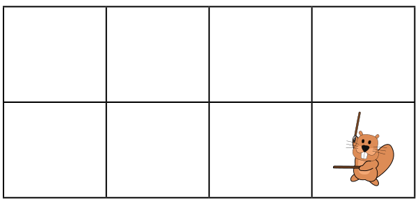

Lucia und ihre Freunde sind Anhänger eines japanischen Spiels mit Stock und Schild. Für ein Foto möchten sie sich auf dem Schulhof so aufstellen, dass jeder Stock auf ein Schild zeigt. Dafür wurden Felder auf den Schulhof gezeichnet (zwei Reihen mit je vier Feldern). Lucia hat sich bereits in Pose gestellt: Sie steht im letzten Feld der unteren Reihe.

Die Bilder der sieben Freunde zeigen sie in ihren Lieblingsposen. Am Ende muss jeder Stock auf ein Schild zeigen.

**Bringe die Bilder der Freunde in die Reihenfolge, in der sie auf die Felder gehören.** Die Felder werden von links nach rechts gezählt, zuerst die obere Reihe (Feld 1 bis 4), dann die untere Reihe (Feld 5 bis 7 – das achte Feld gehört Lucia).
