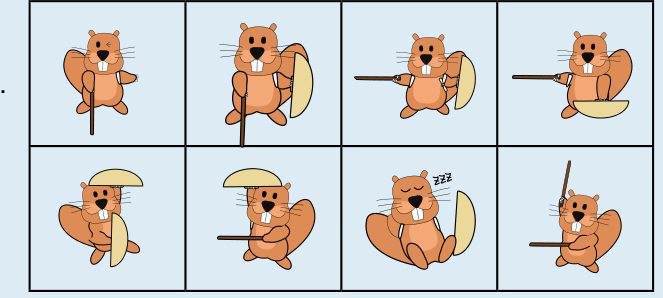

Die Bilder der Freunde müssen so in die Felder bewegt werden, wie es im Bild gezeigt wird. Dann zeigt jeder Stock auf ein Schild. Eine andere Möglichkeit, die Bilder so anzuordnen, dass diese Bedingung erfüllt ist, gibt es nicht.

## Das ist Informatik!

Sieben Bilder müssen an die richtige Stelle geschoben werden. Wer versucht, diese Aufgabe durch einfaches Ausprobieren zu lösen, braucht viel Zeit. Denn es gibt 1 · 2 · 3 · 4 · 5 · 6 · 7 = 5040 verschiedene Möglichkeiten, die sieben Bilder zu arrangieren. Die meisten davon sind natürlich falsch. Mit ein bisschen Logik findest du die Lösung schneller. Überlegen wir mal:

1. Alle Biber, die einen Stock oder ein Schild nach oben halten, müssen in der unteren Reihe stehen.
2. Alle Biber, die einen Stock oder ein Schild nach unten halten, müssen in der oberen Reihe stehen.
3. Es gibt nur einen einzigen Biber, der sein Schild nach unten hält und deshalb oberhalb von Lucia stehen kann.

Mit diesen Regeln kannst du den Suchraum für das Finden einer richtigen Lösung auf wenige Möglichkeiten eingrenzen. Ein Verfahren zum systematischen Ausprobieren aller Lösungsmöglichkeiten nach dem Prinzip von „Versuch und Irrtum“ ist das Backtracking. Ein solches Verfahren ist aber nur dann schnell genug, wenn der Suchraum klein ist. Deshalb ist das Eingrenzen durch logische Regeln so wichtig.
