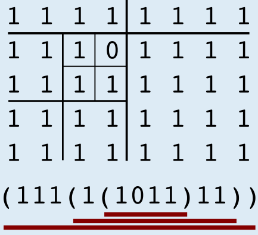

Antwort **D** ist richtig.

Die Anwendung des Verfahrens Viertel verläuft so (siehe auch das Bild):

Zunächst sind nicht alle Zeichen im Raster gleich. Das Raster wird also in vier Raster aufgeteilt. Das Gesamtergebnis wird also so aussehen: `( <Ergebnis 1> <Ergebnis 2> <Ergebnis 3> <Ergebnis 4> )`

In den Teil-Rastern 1, 2 und 3 sind jeweils alle Zeichen gleich 1. Für diese Raster ist das Ergebnis deshalb 1. Das Gesamtergebnis wird also so aussehen: `( 1 1 1 <Ergebnis 4> )`

Das Teil-Raster 4 muss aufgeteilt werden. In den Teil-Rastern 4.1, 4.3 und 4.4 sind jeweils wieder alle Zeichen gleich 1. Damit wissen wir, dass das Gesamtergebnis so aussehen wird: `( 1 1 1 ( 1 <Ergebnis 4.2> 1 1 ) )`

Teil-Raster 4.2 muss aufgeteilt werden. Dabei entstehen nur einzelne Zeichen. Das Ergebnis für dieses Teil-Raster ist damit `( 1 0 1 1 )`.

Das (Gesamt-)Ergebnis ist also: `( 1 1 1 ( 1 ( 1 0 1 1 ) 1 1 ) )`

## Das ist Informatik!

Wenn immer mehr Informatiksysteme wie PCs, Smartphones und Tablets benutzt werden, entstehen immer mehr digitale Daten. Und auch wenn die Systeme immer mehr Kapazität zum Speichern und Übertragen digitaler Daten besitzen: es reicht nie aus. Es bleibt also interessant, sich zu überlegen, wie man Texte, Bilder, Audio- oder Videodaten komprimieren kann, also so zu speichern, dass man möglichst wenig Speicherplatz braucht und keine Information verloren geht.

Die Informatik kennt viele Verfahren, Daten verlustfrei zu komprimieren. Das in dieser Aufgabe beschriebene Verfahren funktioniert am besten, wenn große Bereiche gleiche Daten enthalten. Die Aufteilung in vier gleich große Bereiche (und ggf. deren Aufteilung in vier weitere Bereiche usw.) kann man mit Hilfe sogenannter Quadtrees im Computer nachvollziehen. Ein Quadtree ist eine besondere Variante der Datenstruktur Baum, die in der Informatik eine besonders wichtige Rolle spielt.
