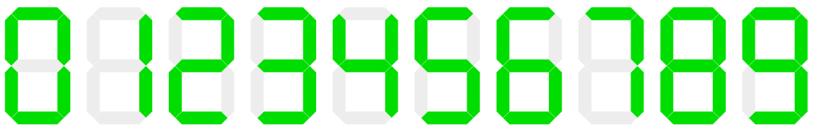

In einem Haus mit 10 Stockwerken zeigt der Aufzug das aktuelle Stockwerk mit einer 7-Segment-Anzeige an. Die Ziffern 0 (für Erdgeschoss) bis 9 sehen dabei so aus:

Um eine Ziffer anzuzeigen, leuchten also mindestens 2 und höchstens 7 Segmente. Vor Kurzem war ein Segment kaputt und blieb dunkel. Trotzdem konnte man alle Ziffern erkennen und voneinander unterscheiden. Die meisten Segmente müssen aber immer funktionieren, damit man die Ziffern voneinander unterscheiden kann.

**Markiere alle Segmente, die immer funktionieren müssen!** Klicke dazu auf die Segmente der Anzeige.
