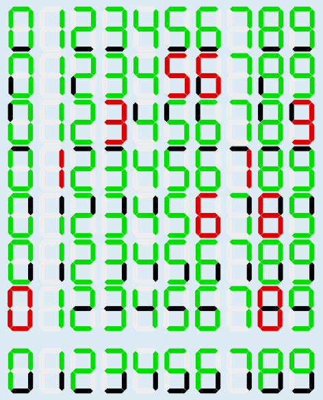

Es müssen fünf Segmente immer funktionieren: das obere, das mittlere, die beiden oberen senkrechten und das linke untere (zusammen sieht das aus wie ein „P“). Nur das untere und das rechte untere Segment dürfen ausfallen.

Wenn nach dem Ausfall eines Segmentes mindestens zwei Ziffern nicht mehr unterscheidbar sind, muss dieses Segment immer funktionieren. Im Bild ist in jeder der oberen sieben Zeilen ein bestimmtes Segment abgeschaltet. Die abgeschalteten Segmente sind schwarz eingefärbt. In fünf Zeilen sind dann zwei Ziffern nicht mehr unterscheidbar; diese Ziffern sind rot eingefärbt. Die in diesen Zeilen abgeschalteten Segmente müssen also immer funktionieren.

Heißt das, dass die verbleibenden zwei Segmente nicht immer funktionieren müssen? Das prüfen wir in der letzten Zeile erfolgreich nach. In der letzten Zeile im Bild sind diese beiden Segmente abgeschaltet. Trotzdem sind alle Ziffern unterscheidbar, weil keine zwei gleichen Muster von leuchtenden Segmenten entstehen.

## Das ist Informatik!

Es gibt 27 = 128 Möglichkeiten, wie die einzelnen Segmente einer 7-Segment-Anzeige ausfallen können. Nun könnte man versuchen wollen, alle Möglichkeiten durchzuprobieren. Diese Vorgehensweise nennt man Brute-Force-Methode (von englisch „brute force“ für „rohe Gewalt“) oder erschöpfende Suche – durch die Menge möglicher Datenkonstellationen, die potenziell für die Bestimmung einer Lösung interessant sind. Bei den allermeisten realen Informatikproblemen ist aber nicht genügend Zeit, um alle diese Möglichkeiten komplett zu durchsuchen. Man muss also eine Lösungsstrategie entwickeln.

In der obigen Erklärung werden einzelne Segmente isoliert betrachtet. Das Problem wird so in kleinere Teilprobleme zerlegt. Das ist eine der Methoden des informatischen Denkens (englisch: Computational Thinking). In diesem Fall konzentriert man sich zunächst auf einzelne Segmente. Letztendlich muss man aber noch nachprüfen, ob die Kombination der einzelnen gefundenen Segmente tatsächlich eine Lösung darstellt.
