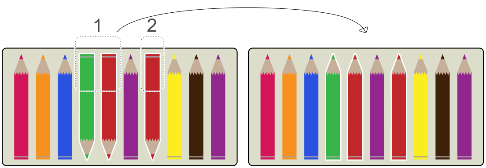
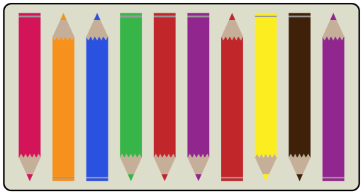

Ada hat eine Schachtel mit 10 Stiften. Einige zeigen nach oben, einige zeigen nach unten. Ada möchte, dass alle Stifte nach oben zeigen.

Ada kann Stifte, die nebeneinander liegen, auf einmal umdrehen. Wenn die Stifte so liegen, muss sie nur zweimal Stifte umdrehen:

Nun liegen die Stifte so:

**Wie oft muss Ada mindestens Stifte umdrehen, damit alle Stifte nach oben zeigen?**
