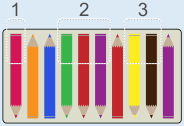

3 ist die richtige Antwort. Ada muss dreimal Stifte umdrehen. Dreimal zeigen Stifte nebeneinander nach unten:

## Das ist Informatik!

Ada hätte wahrscheinlich genug Zeit, jeden Stift, der nicht nach oben zeigt, einzeln umzudrehen. Für sie ist es nicht so wichtig, die Stifte in „Blöcken" umzudrehen, wie sie das in dieser Biberaufgabe macht. Computer haben es da nicht so einfach. Sie haben es nicht mit einigen wenigen Stiften zu tun, sondern müssen meist sehr viele Daten bearbeiten. Da ist es gut, wenn sie möglichst viel auf einmal tun können und deshalb mit ihrer Arbeit schnell fertig werden.

Schnelligkeit ist zum Beispiel beim Lesen und Schreiben von Daten auf Datenspeicher erwünscht. Solche Speicher sind deshalb in Blöcken organisiert. Der Computer kann Daten in einem Block auf einen Schlag lesen oder auch schreiben – so wie Ada Blöcke von Stiften, die nach unten zeigen, auf einen Schlag umdrehen kann. Das spart Zeit.

Übrigens: Je größer die Blöcke sind, desto mehr Zeit wird gespart – aber auch mehr Platz verschwendet. Stell dir vor, Ada legt ihre 10 Stifte in 4er-Schachteln. Dann braucht sie drei Schachteln und lässt Platz für zwei Stifte leer. Benutzt sie 8er-Schachteln, braucht sie zwar nur zwei Schachteln, lässt aber Platz für sechs Stifte leer. Das ist oft so in der Informatik: Man kann entweder Zeit oder Platz sparen, aber nicht beides gleichzeitig.
