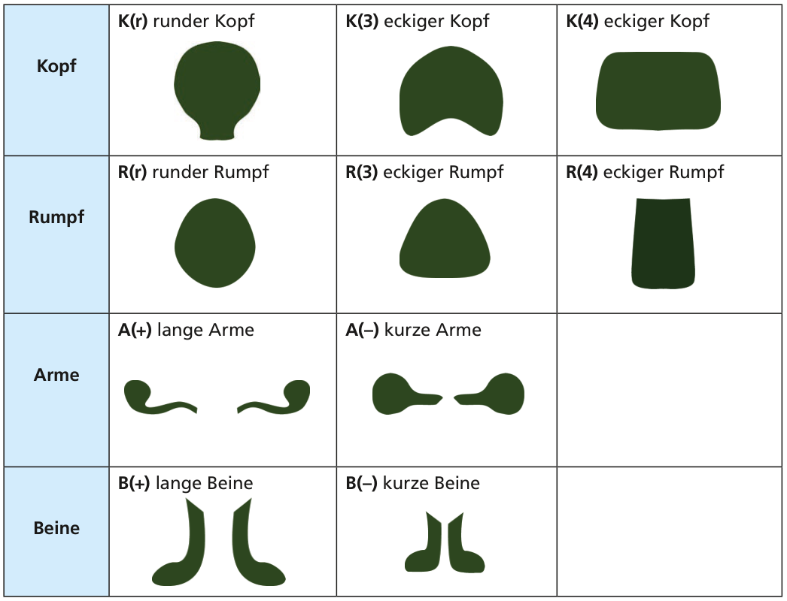

In einem Computerspiel kann man sich Aliens basteln. Mit diesen Befehlen erstellt man die einzelnen Körperteile:

Werden mehrere Befehle für einen Körperteil verwendet, gilt der letzte.

Ein Beispiel: Mit den Befehlen K(r), R(4), K(4), A(–), B(–) bastelt man sich dieses Alien:

**Welches Alien bastelt man sich mit diesen Befehlen: K(3), B(+), R(3), A(+), K(r), A(–), R(r)?**
