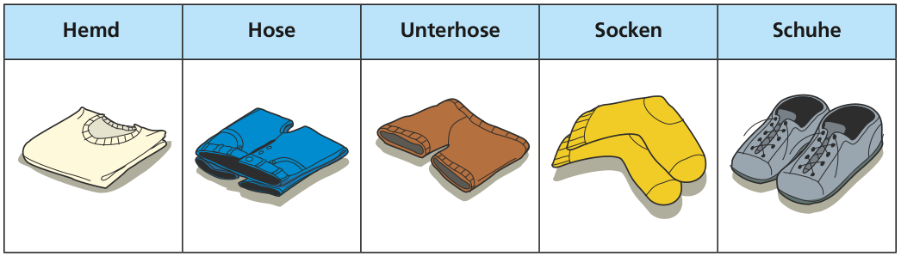

Das sind Brunos Anziehsachen:

Abends legt Bruno seine Sachen auf einen Stapel. Dann geht es morgens schnell: Er zieht zuerst die oberste Sache an, dann die nächste – schön der Reihe nach.

Aber manchmal ist der Stapel falsch: Dann sind am Ende die Socken über den Schuhen oder die Unterhose über der Hose. Oh je!

Diese Stapel sind fast alle falsch. Nur einer ist richtig.

**Welcher?**
