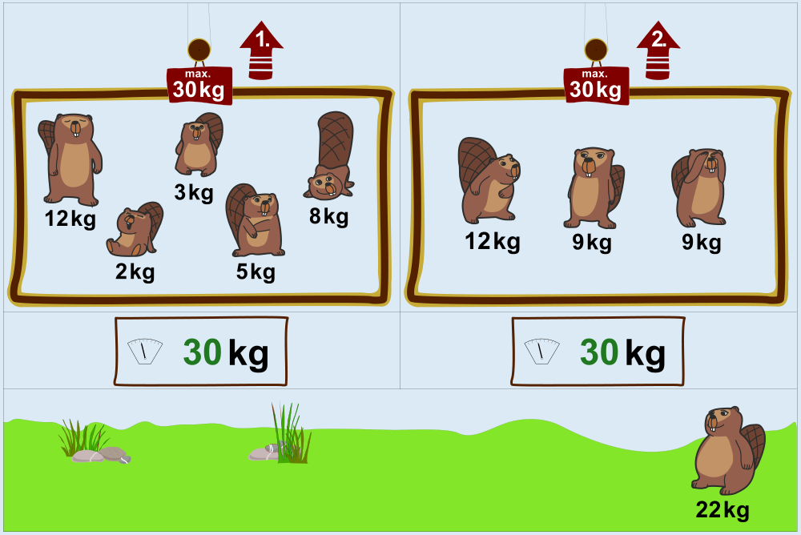

So können acht Biber auf die Aufzüge verteilt werden: In einen Aufzug kommen 12 kg, 2 kg, 3 kg, 5 kg und 8 kg (zusammen 30 kg), in den anderen 12 kg, 9 kg und 9 kg (zusammen 30 kg). Der Biber mit 22 kg bleibt draußen.

Da beide Aufzüge gleich viel Gewicht transportieren können, können die Biber aus Aufzug 1 auch mit Aufzug 2 fahren – und umgekehrt. Außerdem können die beiden 12 kg schweren Biber ausgetauscht werden. Bei allen anderen Verteilungen von Bibern auf die Aufzüge, bei denen das maximale Transportgewicht nicht überschritten wird, passen weniger Biber in die Aufzüge hinein.

## Das ist Informatik!

Viele Menschen sind fasziniert davon, Dinge zu optimieren – häufig übrigens, um Kosten zu sparen und so Profit zu maximieren. Auch ein wichtiger Bereich der Informatik befasst sich mit Verfahren zur Optimierung. Computerprogramme helfen dann dabei, vorhandene Ressourcen (wie die Aufzüge in dieser Biberaufgabe) optimal, also möglichst sparsam zu nutzen.

Manche Optimierungsprobleme lassen sich mit einem „gierigen" (engl.: greedy) Algorithmus lösen. Dabei wird jeder Schritt zur Lösung (hier: die Platzierung eines Bibers in einen Aufzug) so gewählt, dass er möglichst viel Gewinn bzgl. des Findens einer besten Lösung bringt – das ist gierig. In dieser Biberaufgabe würde man z. B. „gierig" vorgehen, wenn man zuerst einen Aufzug füllt und den nächsten Biber so platziert, dass der Aufzug danach noch möglichst viel Gewicht aufnehmen kann: Leichte Biber zuerst! Doch mit diesem Vorgehen würde man die beste Verteilung der Biber nicht finden. Auch bei vielen anderen Optimierungsproblemen hilft ein gieriger Algorithmus nicht weiter, und komplexere Algorithmen werden benötigt, um optimale Lösungen zu finden.

Gier ist nicht die Lösung, und Ressourcen sollen sparsam genutzt werden: Wer sagt da noch, dass man von der Informatik nichts Allgemeines lernen kann!
