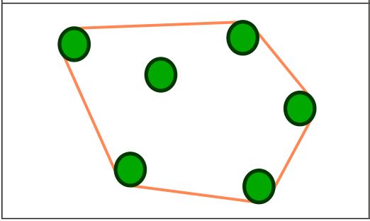
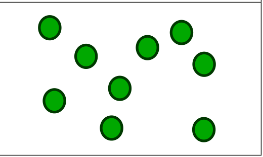

Die Biber spannen immer ein langes Band um Bäume, die sie fällen wollen.

Gestern wollten sie sechs Bäume fällen. Das Band hat aber nur fünf Bäume berührt. Aus der Luft sah das so aus:

Heute wollen die Biber diese Bäume fällen:

**Wie viele Bäume berührt das gespannte Band diesmal?**
