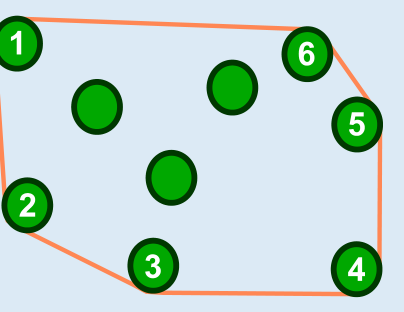

Antwort C ist richtig: Die Biber spannen das Band so um die Bäume:

Das Band berührt die sechs äußeren Bäume.

## Das ist Informatik!

Wenn die Bäume im Lösungsbild winzige Punkte wären, hätte das Biber-Bäume-Band die Form eines Sechsecks. Dieses Sechseck ist das kleinste Vieleck, auf dem alle zu fällenden Bäume stehen. Ein solches kleinstes Vieleck, das alle Punkte aus einer vorgegebenen Menge enthält, heißt in der Mathematik auch „konvexe Hülle" dieser Punktmenge. Dabei bedeutet „konvex", dass sich etwas nach außen dehnt, wie z. B. die konvexe Linse einer Lupe. Und eine „Hülle" ist etwas, das etwas anderes umschließt, so wie die Haut den Körper, dabei aber nicht größer als nötig ist. Das Biber-Bäume-Band ist also wie eine solche konvexe Hülle: Es umschließt alle Bäume und geht zwischen zwei Bäumen nicht nach innen – und „nicht nach innen" ist in der Mathematik schon so viel wie „nach außen".

In der Informatik ist es häufig wichtig, die konvexe Hülle einer Menge von Punkten zu berechnen:

- Mustererkennung: Ist in einem Bild ein Gesicht zu sehen?
- Handschrifterkennung: Ist ein handgeschriebenes Zeichen der Buchstabe B?
- Geographische Informationssysteme: Wie groß ist ein Überschwemmungsgebiet oder ein Flusssystem?
- Verpackungen: Was ist die kleinste Menge an Material, die genügt, einen bestimmten Gegenstand zu verpacken?

Die Informatik kennt Verfahren, welche die konvexe Hülle einer Punktmenge effizient berechnen können. Sie funktionieren also auch dann noch gut, wenn die Punktmenge sehr groß ist.
