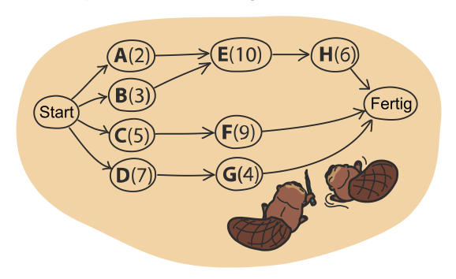
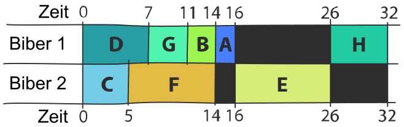

Zwei Biber bauen einen Damm. Dazu müssen sie acht Aufgaben erledigen: Bäume fällen, Äste entfernen, Stämme ins Wasser bringen usw.

Die Biber machen sich erstmal ein Bild. Für jede Aufgabe gibt es einen Buchstaben. In Klammern steht, wie viele Stunden es dauert, die Aufgabe zu erledigen. Ein Pfeil sagt, dass eine Aufgabe vor einer anderen erledigt werden muss. Zum Beispiel kann E erst begonnen werden, wenn A und B beide erledigt sind.

Die Biber können gleichzeitig arbeiten, aber an unterschiedlichen Aufgaben. Hier ist ihr Arbeitsplan. Damit wird der Damm in 32 Stunden fertig. Es geht aber schneller!

**Erstelle einen Arbeitsplan, mit dem der Damm so schnell wie möglich fertig wird!**

Füge dazu die Aufgaben nacheinander zu einem Biber hinzu. Aufgaben, die noch nicht begonnen werden können, sind grau hinterlegt. Wenn du mit dem Plan noch nicht zufrieden bist, nimm Aufgaben wieder heraus.
