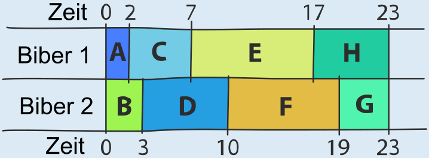

Im Arbeitsplan aus der Aufgabe hat der erste Biber eine lange Pause (10 Stunden), und der zweite Biber hat insgesamt 8 Stunden lang Leerlauf. Die beiden wären schneller fertig, wenn sie ständig arbeiteten.

Man kommt zu einem insgesamt schnelleren Arbeitsplan, wenn man darauf achtet, dass die beiden größten Aufgaben E(10) und F(9) nicht vom selben Biber ausgeführt werden. Hier ist ein Arbeitsplan, der mit 23 Stunden auskommt (Biber 1: A, C, E, H; Biber 2: B, D, F, G). Schneller geht es nicht, denn die beiden Biber arbeiten ohne Pause.

## Das ist Informatik!

Menschen sind ungeduldig, und deshalb wird oft verlangt, dass Arbeiten möglichst schnell erledigt werden. Wenn mehrere „Betriebsmittel" zur Verfügung stehen, seien es Menschen, Maschinen oder Biber, spielt die Verteilung der „Jobs" auf diese Betriebsmittel für die Schnelligkeit eine wichtige Rolle.

Auch in Computern sollen die Jobs, die durch die vielen, gleichzeitig darauf ablaufenden Prozesse zu erledigen sind, gut auf die Betriebsmittel, etwa die Prozessorkerne verteilt werden. Für dieses „Scheduling" gibt es viele verschiedene, von der Informatik gut untersuchte Strategien. Der Arbeitsplan in dieser Biberaufgabe wurde so erstellt, dass unter den anstehenden Jobs der mit der längsten Dauer einem gerade „arbeitslosen" Biber zugeteilt wurde – in diesem Fall eine schlechte Strategie. Im Allgemeinen funktioniert es besser, wenn kurze Jobs zuerst erledigt werden: Die Strategie „shortest-job-next" (kürzester Job zuerst) führt zu einer im Durchschnitt minimalen Wartezeit der Jobs.
