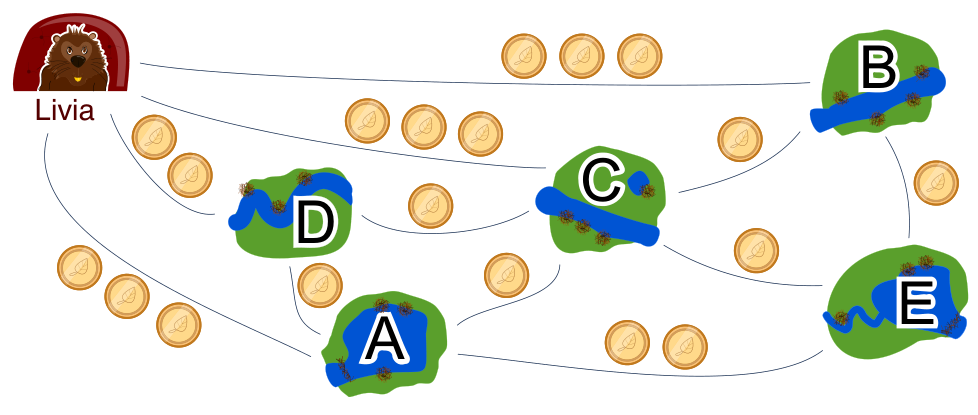

Biber Livia will ihre Freunde mit dem Bus besuchen. Die Freunde leben in den Dörfern A, B, C, D und E. Zwischen den Dörfern gibt es Busverbindungen. Das Bild zeigt, wie viel die einfache Fahrt jeweils kostet. Livia plant eine Bibertour: Sie startet an ihrem Bau, besucht jedes Dorf genau einmal und kehrt dann zu ihrem Bau zurück.

Zum Beispiel ist das eine Bibertour: Bau → B → E → A → D → C → Bau. Diese Bibertour kostet 11 Bibertaler.

**Finde eine Bibertour, die so wenig wie möglich kostet.**

Bringe die Dorf-Buchstaben A bis E in die richtige Reihenfolge, um die Bibertour zu beschreiben. Gibt es mehrere Bibertouren, die gleich wenig kosten, kannst du irgendeine davon beschreiben.
