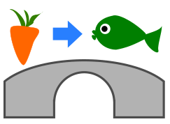

Von einem Berg kommen drei Flüsse. Sie fließen unter Brücken hindurch.

Katja kann einen Gegenstand in einen der drei Flüsse fallen lassen: ein Stück Holz, einen Fisch oder eine Karotte.

Unter allen Brücken sitzen Trolle. Sie ersetzen Gegenstände, die unter den Brücken hindurch fließen. Der Troll unter der Brücke oben links ersetzt zum Beispiel jede Karotte durch einen Fisch:

Justus wartet hinter der letzten Brücke. Er möchte ein Stück Holz bekommen. Katja weiß, was die Brückentrolle machen.

**Was muss Katja tun, damit Justus Holz bekommt?**
