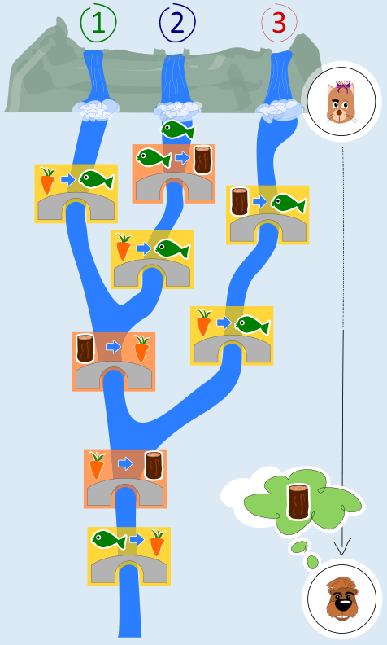

Antwort B ist richtig: Wenn Katja einen Fisch in Fluss 2 fallen lässt, werden drei Trolle aktiv – siehe Bild. Der erste Troll ersetzt den Fisch durch ein Stück Holz. Der Troll an der nächsten Brücke hat dann nichts zu tun. Eine Brücke weiter ersetzt der Troll das Stück Holz durch eine Karotte. Der Troll von der nächsten Brücke ersetzt die Karotte wieder durch ein Stück Holz. Der Troll an der letzten Brücke hat dann ebenfalls nichts zu tun. Justus kann das Stück Holz aus dem Fluss fischen.

Bei den anderen Antworten bekommt Justus kein Holz.

- Antwort A: Wenn Katja einen Fisch in Fluss 1 fallen lässt, wird der an der letzten Brücke durch eine Karotte ersetzt.
- Antwort C: Wenn Katja eine Karotte in Fluss 3 fallen lässt, wird diese zwischendurch durch einen Fisch ersetzt. Der Fisch wird dann an der letzten Brücke durch eine Karotte ersetzt.
- Antwort D: Wenn Katja ein Stück Holz in Fluss 3 fallen lässt, wird dieses an der ersten Brücke durch einen Fisch ersetzt. Der Fisch wird, wie bei Antwort C, an der letzten Brücke durch eine Karotte ersetzt. Wieder kein Holz für Justus!

## Das ist Informatik!

Die Brückentrolle arbeiten nach dem EVA-Prinzip der Datenverarbeitung: Katjas **E**ingabe wird von ihnen **v**erarbeitet, und Justus erhält die **A**usgabe. Ein System, das rein nach diesem Prinzip arbeitet, muss sich nichts merken: Die Ausgabe hängt nur von der Eingabe ab, nicht aber davon, was bei früheren Verarbeitungen passiert ist. Das ist wie bei einer Funktion in der Mathematik, wo der Funktionswert nur vom Argumentwert abhängt.

Gemeinsam arbeiten die Brückentrolle in dieser Biberaufgabe also wie eine Funktion. Aber auch jeder einzelne tut das. Die große Brückentroll-Funktion ist so aus vielen kleinen Brückentroll-Funktionen zusammengesetzt. Es gibt Programmiersprachen, die ganz ähnlich nur die Programmierung von Funktionen und deren Zusammensetzung zu komplexeren Funktionen erlauben. Die funktionalen Programme, die man in diesen Sprachen schreiben kann, lassen sich gut analysieren und auf ihre Korrektheit prüfen – dank des EVA-Prinzips.
