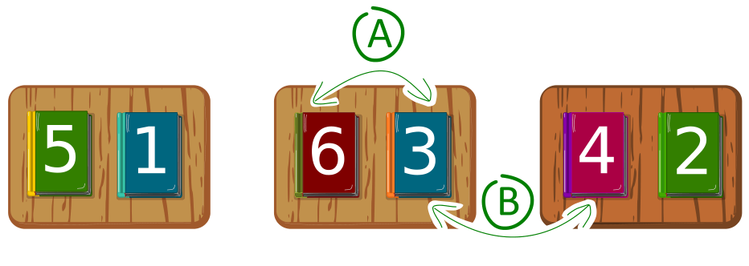

In einer Bibliothek sitzen drei weise Personen nebeneinander, jede an einem Tisch mit zwei Büchern. Mit einem Spiel wollen sie die Bücher sortieren: Büchertausch. Das Spiel läuft in Runden ab. Es gibt zwei Arten von Runden:

- **A)** Die beiden Bücher auf jedem Tisch dürfen (müssen aber nicht) getauscht werden.
- **B)** Jedes Buch darf (aber muss nicht) mit einem benachbarten Buch von einem Nachbartisch getauscht werden.

A- und B-Runden wechseln sich ab. Das Spiel beginnt mit einer A-Runde. In jeder Runde darf jedes Buch höchstens einmal getauscht werden.

Am Anfang liegen die Bücher wie im Bild.

**Wie viele Runden sind insgesamt mindestens notwendig, um die Bücher zu sortieren, also in diese Reihenfolge zu bringen: 1, 2, 3, 4, 5, 6?**
