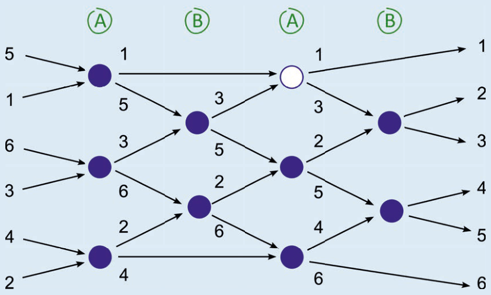

Antwort B ist richtig: Das Bild zeigt, wie die Bücher beim Büchertausch sortiert werden. In jeder Runde werden die benachbarten Bücher, die gerade getauscht werden dürfen, miteinander verglichen. Wenn diese beiden Bücher schon sortiert sind (das linke Buch hat eine kleinere Nummer als das rechte Buch), dann passiert nichts. Ansonsten werden die Bücher getauscht.

In der ersten Runde (Art A) werden auf jedem Tisch die beiden Bücher getauscht. In der zweiten Runde (Art B) werden benachbarte Bücher von Nachbartischen getauscht. In der dritten Runde (wieder Art A) werden nur auf den beiden rechten Tischen die Bücher getauscht, und in der vierten Runde (wieder Art B) werden alle benachbarten Bücher von Nachbartischen getauscht: fertig. Schneller geht es nicht. Denn z. B. Buch 5 muss um vier Positionen nach rechts wandern. Dazu muss es mindestens vier Mal getauscht werden, denn bei jedem Tausch kann ein Buch sich nur um eine Position bewegen.

## Das ist Informatik!

Das Sortieren in dieser Biberaufgabe liefert ein Beispiel für einen parallelen Algorithmus: ein Sortiernetz. Ein Sortiernetz kann, wie oben, durch Pfeile und Kreise dargestellt werden. Die Kreise stellen die Vergleichseinheiten dar. Die Pfeile zeigen, wie sich die zu sortierenden Objekte zwischen den Einheiten bewegen. Zu jeder Einheit führen zwei Pfeile, so dass auf einem Knoten zwei Objekte miteinander verglichen werden können. Wieder zwei Pfeile führen von jeder Einheit weg; auf dem oberen bewegt sich das kleinere Objekt weiter, auf dem unteren das größere. Wenn man den Pfeilen von links nach rechts folgt, kann man erkennen, wie ein Objekt nach einigen Vergleichen allmählich seine richtige Position in der angestrebten Reihenfolge einnimmt.

Die Einheiten, die im Bild übereinander stehen, können ihre Vergleiche gleichzeitig, also parallel ausführen. Durch die Parallelität sind Sortiernetze oft schneller als nicht-parallele Sortierverfahren.
