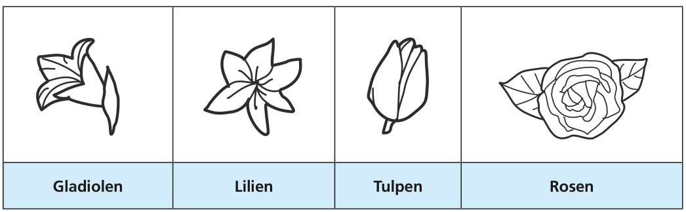

Clara liebt Blumen! Im Blumenladen gibt es diese Sorten:

Jede Sorte ist in diesen Farben erhältlich: **Weiß**, **Blau** und **Gelb**.

Clara möchte einen Blumenstrauß kaufen. Aber sie hat besondere Wünsche:

1. Jede Farbe soll genau zweimal vorkommen,
2. Blumen der gleichen Sorte sollen nicht die gleiche Farbe haben und
3. jede Sorte darf höchstens zweimal vorkommen.

**Welchen Blumenstrauß wird Clara kaufen?**
