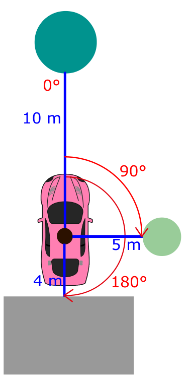
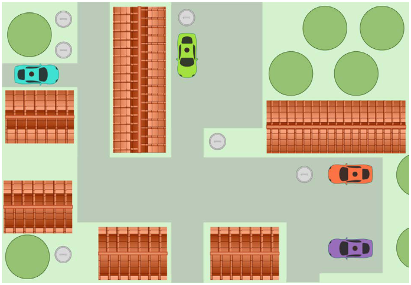

Ein selbstfahrendes Auto wird vermisst. Es blieb mit leerem Akku irgendwo in der Stadt stehen. So ein Pech!

Kurz vorher konnte das vermisste Auto noch ein Modell seiner Umgebung senden. In diesem Modell wird jedes Objekt, das der 360°-Sensor erfasst hat, durch zwei Werte beschrieben:

1. Der Winkel der Blickrichtung des Sensors zu dem Objekt (siehe Bild). Geradeaus ist 0°.
2. Die Entfernung vom Sensor zu dem Objekt.

In dem Beispiel ist das Modell [(0, 10), (90, 5), (180, 4)].

Das vermisste Auto sendete dieses Modell: [(0, 5), (90, 3), (180, 5), (270, 8)].

**Finde das vermisste Auto auf der Karte!**

Wähle das vermisste Auto durch einen Klick aus.
