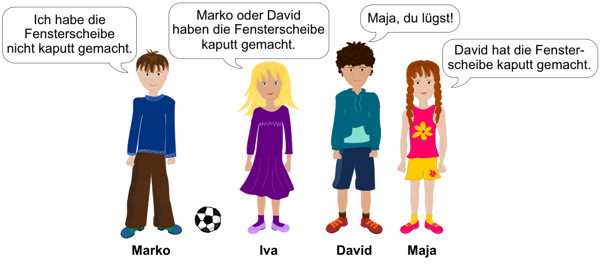

Maja, David, Iva und Marko spielen Fußball bei Annas Haus. Auf einmal geht eine Fensterscheibe kaputt. Anna fragt die vier Kinder, wer es war. Anna weiß, dass drei von ihnen immer die Wahrheit sagen. Bei dem vierten Kind weiß sie es nicht.

**Wer hat die Fensterscheibe kaputt gemacht?**

Lies genau durch, was die Kinder sagen. Wähle dann ein Kind aus.

