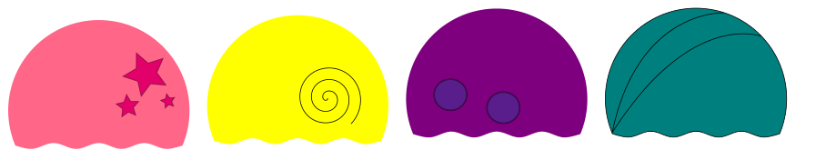

Die Eisdiele „Al Goritmo“ bietet diese vier Eissorten an:

Bei Al Goritmo werden die Eishörnchen streng nach dieser Vorschrift hergestellt:

- Schritt 0: Nimm ein leeres Hörnchen.
- Schritt 1: Wähle zufällig eine Eissorte und gib zwei Kugeln dieser Eissorte hinzu.
- Schritt 2: Gib eine Kugel mit irgendeiner anderen Eissorte als in Schritt 1 hinzu.
- Schritt 3: Wenn die gewünschte Kugelzahl erreicht ist, höre auf. Ansonsten mache mit Schritt 1 weiter.

Unten siehst du einige Eishörnchen mit ihren unteren Kugeln.

**Welches Eishörnchen stammt mit Sicherheit NICHT von Al Goritmo?**
