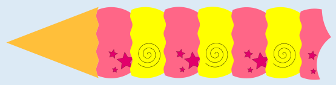

Antwort D ist richtig: Das ist das einzige Eishörnchen, das ganz eindeutig nicht nach den Anweisungen hergestellt worden ist. Es beginnt korrekt mit zwei türkisen Kugeln, also zwei Kugeln der gleichen Eissorte (Schritt 1), gefolgt von einer Kugel einer anderen Eissorte, einer rosa Kugel (Schritt 2). Dann jedoch kommen zwei Kugeln unterschiedlicher Sorten, eine rosa und eine violette, obwohl nun wieder Schritt 1 der Vorschrift an der Reihe ist und damit zwei Kugeln der gleichen Sorte kommen müssten.

Die Antworten A, B und C sind nicht richtig. Diese Eishörnchen wurden nach der Vorschrift von Al Goritmo hergestellt, zumindest soweit man es erkennen kann: Es folgen wiederholt Gruppen von zwei gleichen Kugeln und einer anderen Kugel aufeinander.

## Das ist Informatik!

Muster in Eishörnchen, Texten oder Bildern können durch Anweisungsfolgen erzeugt werden. Informatikerinnen und Informatiker entwickeln Computerprogramme, mit denen Muster und Abweichungen von Mustern erkannt werden.

Manchmal entstehen Muster durch Wiederholung von Anordnungen. Ein Beispiel:

Das ist ein einfaches Muster, das durch Wiederholung von einer gelben und einer rosa Kugel entstanden ist. Dieses Muster ist leicht zu erkennen. In der Aufgabe ist die Sache schwieriger, weil die Vorschrift der Eisdiele auch Zufallsentscheidungen enthält.

Im Grunde genommen kann man niemals ganz sicher sein, ob eine Reihenfolge durch Zufall oder durch eine Folge von Anweisungen erzeugt worden ist. Bei den Beispielen dieser Aufgabe konnten wir nur bei einem Eis sagen, dass es sicher *nicht* den Anweisungen entsprach und deshalb nicht von Al Goritmo stammen konnte. Man kann aber aufgrund der Zusammensetzung des Eishörnchens niemals sicher entscheiden, ob es von Al Goritmo stammt: Auch bei einer anderen Eisdiele könnte ein Hörnchen erstellt werden, das zufällig der Vorschrift von Al Goritmo entspricht.
