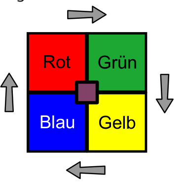
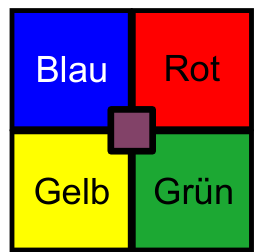

Simon hat ein Spiel mit vier Farben.

Wenn Simon den Knopf drückt, bewegen sich die Quadrate um eins weiter, wie die Pfeile zeigen.

Simon hat den Knopf einmal gedrückt. Jetzt liegen die Farben so:

Simon drückt den Knopf noch einmal.

**Wo liegen danach die Farben?**

Ziehe die Farben auf den richtigen Platz.
