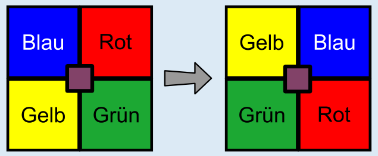

Das Bild zeigt, wohin sich die Quadrate bewegen, wenn Simon den Knopf noch einmal drückt. Danach liegen die Farben so wie im Bild rechts: Gelb oben links, Blau oben rechts, Grün unten links, Rot unten rechts.

## Das ist Informatik!

Wer Computer programmiert, möchte genau wissen, welche Auswirkungen das fertige Programm am Ende hat. Dazu muss insbesondere geklärt sein, welche Auswirkungen jede einzelne Anweisung des Programms hat. Es ist aber gar nicht so leicht, diese Auswirkungen geschickt zu beschreiben. Bei dieser Biberaufgabe kann zum Beispiel für jede Farbanordnung beschrieben werden, in welche Anordnung sie übergeht, wenn Simon den Knopf drückt. Für das Beispiel in der Aufgabenstellung könnte das so lauten: „Blau/Rot/Grün/Gelb" (beginnend unten links; im Uhrzeigersinn) geht über in „Gelb/Blau/Rot/Grün". Das klingt kompliziert, und es ist geschickter, nach Gesetzmäßigkeiten zu suchen und diese zu beschreiben: Durch Knopfdruck rückt jede Farbe im Uhrzeigersinn um genau ein Feld weiter. Daraus lässt sich leichter die Auswirkung einer Reihe von Knopfdrücken festlegen: Zweimaliges Drücken verschiebt jede Farbe in die jeweils gegenüberliegende Ecke, viermaliges Drücken verändert die Farbanordnung nicht.
